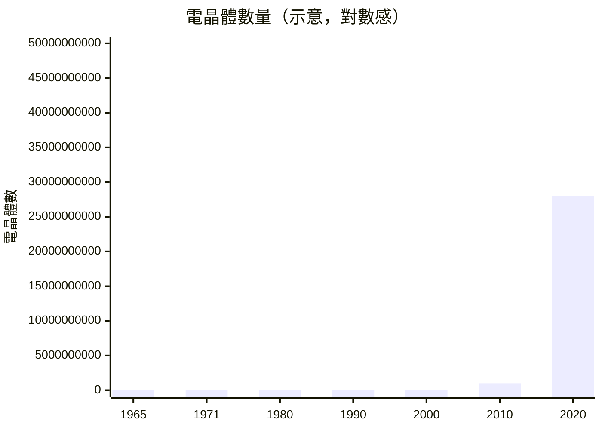
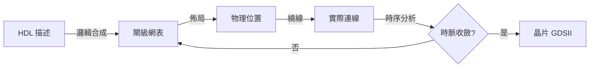

# 1.1 從電晶體到晶片：設計危機的誕生

## 摩爾定律把設計推下懸崖

1965 年，Gordon Moore 觀察到積體電路上可容納的電晶體數量約每 18–24 個月翻倍。這條後來被稱為
**摩爾定律**的經驗曲線，對晶片設計者而言不是福音而是通牒：

> 電晶體數量指數成長，但工程師的精力是線性的。靠人手畫電路圖，永遠追不上製程能給你的東西。

1970 年代的「**設計危機**」於是形成：製程造得出百萬電晶體的晶片，卻沒有人有辦法正確地把它設計出來。
正確性都無法保證，更不用說面積、速度、功耗的品質。這場危機催生了整個 EDA（Electronic Design
Automation）產業——讓電腦來設計電腦的零件。

## 三個層次的自動化需求

設計危機不是一個問題，是三個互相咬合的問題：

1. **正確性**：電路太龐大，人工驗證不可能 → 需要機器可執行的**描述語言**（HDL）與**邏輯合成**
   （把描述自動變成閘電路）。
2. **物理實現**：數十萬閘在矽面上怎麼擺、怎麼連 → 需要自動**佈局**（placement）與**繞線**
   （routing）。
3. **時間正確性**：邏輯對了，但訊號跑得太慢、時脈太快，電路照樣錯 → 需要**時序分析**
   （timing analysis）。

注意這張圖裡的**回饋箭頭**：時序不收斂，就要回到合成或佈局重來。EDA 從來不是單向流水線，
而是迭代收斂的迴圈——這也是本專案把四支程式做成「可獨立跑、可反覆跑」的原因。

## Nand2Tetris 是濃縮的歷史

本專案的硬體線（`third_party/courses/`）正是把這段歷史濃縮成 12 個 project：
學生從一顆 Nand 開始，疊出 ALU、暫存器、記憶體，最後疊出 CPU。
但 Nand2Tetris 課程**在「設計出 HDL」就停了**——真實世界的下一步，把你的 HDL 變成晶片，
正是本專案補上的那一塊：

| 歷史事件 | Nand2Tetris | 本專案補上 |
|---|---|---|
| HDL 描述（1980s Verilog/VHDL） | `.hdl` 檔 | ✅（課程原有） |
| 邏輯合成（Synopsys 1987 成立） | ❌ | `lib/fpga/synthesis.js` |
| 佈局繞線（Cadence 1988） | ❌ | `lib/fpga/pnr.js` |
| 時序分析 | ❌ | 兩套 `analyzeTiming` |

下一節把這四塊拼圖的理論骨架攤開。
