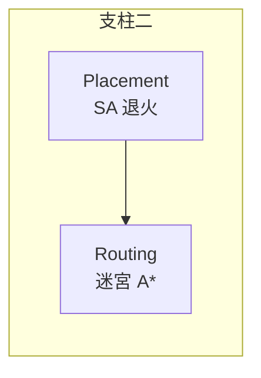

# 1.2 EDA 三大支柱：合成、佈局繞線、時序分析

## 支柱一：邏輯合成（Logic Synthesis）

**輸入**：行為/結構描述（HDL）。**輸出**：目標工藝的閘級網表（netlist）。

理論核心是兩個古典結果：

- **函數完備性**：$\{\text{NAND}\}$ 單獨一個閘就是函數完備的（Sheffer, 1913）。
  任何布林函數都能只用 NAND 疊出來——這是「展平」可以只留 NAND+DFF 的理論根據。
- **兩層式最小化**：Quine–McCluskey（1956）與 Karnaugh 圖（1953）求 SOP 最小項；
  但工業電路是多層式，兩層式最小化指數爆炸，因此現代合成走**多層式最佳化**：
  常數傳遞、共用子表示式、死碼刪除（本專案 `optimizeGates` 做的前兩種＋死碼）。

$$f(x_1,\dots,x_n) \in \mathcal{B}^n \to \mathcal{B},\qquad \mathcal{B}=\{0,1\}$$

合成要回答的問題：**用工藝庫裡的閘（或 FPGA 的 LUT），造出實現 $f$ 的最小/最快電路**。
這是組合最佳化問題，一般情形 NP 困難——所以所有實用合成器都是**啟發式**。

## 支柱二：佈局與繞線（Place & Route）

**輸入**：閘級網表。**輸出**：每個 cell 的座標＋每條 net 的實際走線。

理論核心：

- **佈局** = 二次分配問題（QAP, Koopmans & Beckmann 1957）：把 $n$ 個 cell 放進 $n$ 個槽位，
  最小化 $\sum c_{ij}\, d_{p(i),p(j)}$。NP 困難 → 用**模擬退火**（Kirkpatrick 1983）等隨機搜尋。
- **繞線** = 通道內不交疊地為每條 net 找路徑。單條 net 的最短路是**迷宮演算法**
  （Lee, 1961，BFS 的柵格版）；全局繞線再處理通道容量衝突。

## 支柱三：時序分析（Timing Analysis）

**輸入**：佈局繞線結果＋每個 cell 的延遲。**輸出**：最長路徑延遲 → 最高時脈 $F_{\max}$。

同步電路的鐵律：一個時脈週期 $T$ 內，訊號必須從暫存器出發、穿過組合邏輯、在下一個暫存器
setup 之前穩定。最長組合路徑（**關鍵路徑**）決定了 $T$ 的下限：

$$T \ge t_{\text{clk}\to q} + t_{\text{logic,max}} + t_{\text{setup}}
\qquad\Rightarrow\qquad F_{\max} = \frac{1}{T_{\min}}$$

**靜態時序分析（STA）**的巧妙之處：不跑任何輸入向量，直接在網表上做**拓撲排序的最長路**
（DAG 上動態規劃，$O(|V|+|E|)$）。這是 4.1 節的主題。

## 三支柱的依賴關係

理論上三者是**順序依賴**的：

- 沒有合成 → 沒有網表 → 佈局無從下手；
- 沒有佈局 → 沒有線長 → 繞線與延遲估計失真；
- 沒有繞線 → 延遲只是猜測 → STA 不準。

但工程上常常**用上一步的估計先跑下一步**（例如本專案 FPGA 流程在佈局前就有 LUT 延遲模型、
佈局後才補線延遲）。這種「估計—驗證—收斂」的節奏，是整個 EDA 方法論的靈魂，
也是 1.1 節流程圖裡回饋箭頭的由來。

## 本專案的取捨

真實 EDA 工具（Yosys＋nextpnr、Synopsys DC＋ICC2）動輒數十萬行。本專案的四支程式
刻意只做**每個理論的最小可執行核心**，讓演算法本身完全可見：

| 真實工具 | 本專案 | 核心保留 |
|---|---|---|
| Yosys synth | `MicroSyn` | 展平、代數化簡、LUT 打包 |
| nextpnr | `MicroPnR` | SA 佈局、曼哈頓繞線、STA |
| Design Compiler | `AsicSyn` | 圖樣映射（NAND2/INV/MUX2/AOI21） |
| Innovus | `AsicPnR` | row-based 佈局、經驗 STA |

捨棄的（多時鐘域、power、clock tree、DRC……）會在各章「現實中的工具」段落交代。
