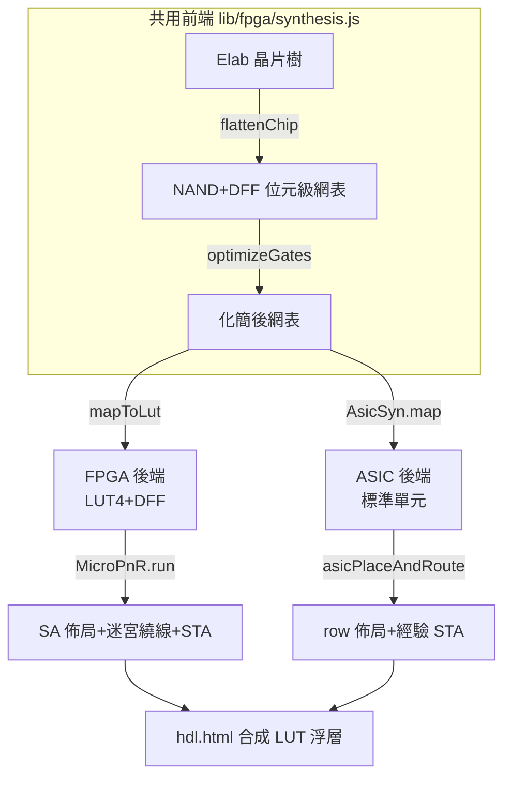

# 1.3 本專案的迷你 EDA：四支程式的地圖

## 兩條後端，一個前端

本專案把 EDA 拆成 **FPGA 與 ASIC 兩條後端**，共用一個前端（展平＋代數最佳化）：



## 四支程式

### `lib/fpga/synthesis.js` — MicroSyn（微型 Yosys）

```js
export class MicroSyn {
  synthesize(elab, topName) {
    const topChip = elab.chips[elab.names[topName]];
    const flat = this.flattenChip(elab, topChip);   // ① 展平
    const opt  = this.optimizeGates(flat);           // ② 代數最佳化
    const netlist = this.mapToLut(opt, topChip);     // ③ LUT4 科技映射
    return netlist;
  }
}
```

- `flattenChip`：遞迴把階層式晶片樹攤平成**位元級 NAND 與 DFF** 的原始網表（第 2.2 節）。
- `optimizeGates`：不動點迭代做常數傳遞、雙重否定、死碼清除（第 2.3 節）。
- `mapToLut`：貪婪錐擴張，把布林錐打包成 4 輸入 LUT 並算出 16-bit 真值表（第 2.4 節）。

### `lib/fpga/pnr.js` — MicroPnR（微型 nextpnr）

```js
export class MicroPnR {
  constructor(options = {}) {
    this.lutDelay  = options.lutDelay  || 1.2;   // ns
    this.dffDelay  = options.dffDelay  || 0.6;   // ns
    this.wireDelay = options.wireDelay || 0.25;  // ns 每單位曼哈頓距離
    this.tracksPerChannel = options.tracksPerChannel || 6;
  }
  run(netlist) {
    const gridSize = Math.max(4, Math.ceil(Math.sqrt(totalCells / 0.6))); // 60% 利用率
    const placement = this.place(netlist, nets, gridW, gridH);   // SA 退火
    const routing   = this.route(nets, placement, gridW, gridH); // 迷宮繞線
    const timing    = this.analyzeTiming(netlist, routing, placement); // STA
    return { grid, placement, routing, timing, stats };
  }
}
```

- 虛擬 FPGA 島嶼架構：CLB 網格＋周圍 I/O pads＋雙向水平/垂直通道（每通道 6 tracks）。
- 佈局用模擬退火最小化**半周長線長** HPWL（第 3.2 節）。
- 繞線用曼哈頓通道路徑（水平後垂直的 L 形，第 3.3 節）。
- STA 沿網表取到達時間最大值，回溯關鍵路徑（第 4.1 節）。

### `lib/asic/synth.js` — AsicSyn（微型 Design Compiler）

```js
export const STDCELL = {
  INV:   { area: 1.0, delay: 0.08 },
  NAND2: { area: 2.0, delay: 0.12 },
  AOI21: { area: 3.2, delay: 0.16 }, // out = !((a & b) | c)
  MUX2:  { area: 4.0, delay: 0.20 }, // out = s ? a : b
  DFF:   { area: 8.0, delay: 0.30, setup: 0.15, hold: 0.05, clkq: 0.30 },
};
```

與 FPGA 版共用前端（flattenChip→optimizeGates 與晶片無關），再對化簡後的 NAND 網表做
**peephole 圖樣重寫**：NAND2/INV 為基底，外加 MUX2、AOI21 兩個圖樣做面積最小化
（單元庫面積/延遲為示意值；碗全樹覆蓋 DP 留待擴充，第 2.4 節比較貪婪與 DP）。

### `lib/asic/pnr.js` — AsicPnR（微型 Innovus）

```js
const ROW_H_UM = 2.2;
const WIRE_NS_PER_UM   = 0.01;  // 每 µm 線延遲（示意）
const LOAD_NS_PER_SINK = 0.02;  // fanout 負載項
```

Row-based 佈局：以拓撲深度（level）成列，DFF 輸出視為新階段（level 重置），
cell 佔寬 ∝ 面積（列高固定 2.2 µm）。線延遲 = 幾何距離（µm）× 0.01 ns/µm ＋ fanout 負載項。
STA 同時做 setup 與 hold 兩向（第 4.2 節），並回溯關鍵路徑的 cell id 列表。

## 怎麼跑

### CLI（headless，第 5 章全部數據的來源）

```bash
node --input-type=module -e "
import { loadLibrary, elab } from './lib/hdl/elab.js';
import { MicroSyn } from './lib/fpga/synthesis.js';
const lib = {};
for (const d of ['third_party/courses/01','third_party/courses/02','third_party/courses/03/a','third_party/courses/03/b','third_party/courses/05'])
  Object.assign(lib, loadLibrary(d));
const e = elab(lib, 'CPU');
console.log(new MicroSyn().synthesize(e, 'CPU').stats);
// { rawGates: 2224, lutCount: 344, dffCount: 48 }
"
```

### 網頁（`dist/hdl.html` 的「合成 LUT」浮層）

語料選單任選晶片（如 `05/CPU`）→ 按「合成 LUT」→ 階段列：

- `共①②③`：兩條後端共用的展平、化簡與抽象視圖；
- `F④⑤⑥⑦`（藍 tag）：FPGA 的 LUT 映射、退火佈局（可播動畫）、繞線、時序；
- `A④⑤⑥⑦`（土黃 tag）：ASIC 的單元映射、row 佈局、線長、時序。

畫布支援滾輪縮放、拖曳平移、點擊 cell 顯示資訊——這本書每一章的演算法，
都能在這個浮層上按出來看到。
