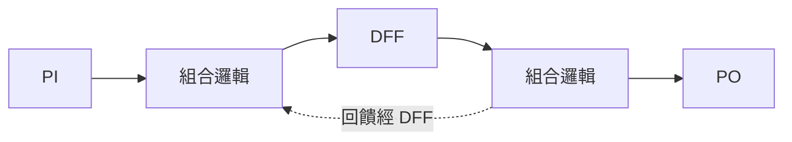

# 2.1 開關理論與布林網路（1938 — Shannon）

## 從邏輯到電路的一躍

1938 年，Claude Shannon 的碩士論文《A Symbolic Analysis of Relay and Switching Circuits》
做了一件改變世界的事：指出**布爾代數（1854, George Boole）與開關電路是同構的**。

- 串聯開關 = AND
- 並聯開關 = OR
- 常閉觸點 = NOT

從此「設計電路」變成「化簡布林函數」——一個純數學問題。這是整個數位電路設計的
第一塊理論基石，也是 EDA 這門學科能存在的原因：**因為電路有代數，所以電路可以被機器化簡。**

$$\text{AND}(a,b) = a \cdot b,\quad
  \text{OR}(a,b) = a + b,\quad
  \text{NOT}(a) = \bar{a}$$

## NAND：一個閘統治一切

1913 年 Henry Sheffer 證明：$\{\uparrow\}$（NAND）單獨就是**函數完備**的——任何布林函數
都能只用 NAND 表達：

$$\bar{a} = a \uparrow a,\qquad
  a + b = (a \uparrow a) \uparrow (b \uparrow b),\qquad
  a \cdot b = (a \uparrow b) \uparrow (a \uparrow b)$$

這個純數學結果有巨大的工程意義：**製造只需聚焦一種閘**。Nand2Tetris 課程從 Nand 開始、
本專案的展平器只輸出 NAND+DFF，都是站在 Sheffer 的肩膀上。

## 布林網路：把電路變成圖

**布林網路**（Boolean network）是有向無環圖（DAG）：

- 節點 = 閘（或更一般地，布林函數）；
- 邊 = 接線（net）；
- 入度 0 的節點 = 初級輸入（PI），出度 0 = 初級輸出（PO）。

加上**時序元件**（DFF）後，電路被 DFF 切成一個個組合區域：

DAG 這個性質極其重要：**組合邏輯裡沒有環**，所以一切「沿訊號流動方向算一遍」的演算法
（求值、到達時間、錐擴張）都只需一次拓撲排序，$O(|V|+|E|)$。
時序電路的環全部經過 DFF，而 DFF 把環切斷成一拍一拍——這就是第 4 章 STA 能成立的拓撲前提。

## 為什麼是位元級？

高層描述（`ALU.hdl` 的一個 Add16）在數學上是「向量函數」，但物理實現是**一根一根線**。
合成器的第一步永遠是**降位元**（bit-blasting）：把 16-bit 加法器拆成 16 個 1-bit 全加器、
每個輸出位元變成一個獨立的布林網路節點。

本專案 `flattenChip` 產出的就是位元級網表：每個閘是
`{ type: 'NAND' | 'DFF', in: [net, net], out: net }`，
net 是字串名稱，常數則直接用 `'0'`/`'1'` 兩個保留名。

## 理論與程式的對應表

| 理論概念 | 程式中的實體 |
|---|---|
| 函數完備性（Sheffer 1913） | 展平只留 NAND（`flattenChip`） |
| 布林網路 DAG | `opt.gates` 陣列（拓撲序可求得） |
| PI / PO | `opt.primaryInputs` / `opt.primaryOutputs` |
| 時序切分 | DFF 閘（`type === 'DFF'`） |
| 位元級化 | slice 逐位元展開（elab 的 per-bit Wire） |

下一節走進 `flattenChip`，看階層樹怎麼攤平成這張網表。
