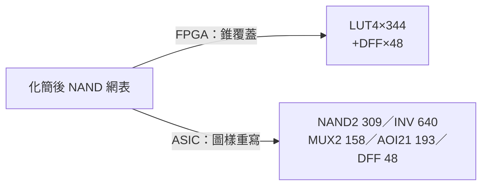

# 2.4 科技映射：LUT4 貪婪錐覆蓋

## 為什麼要「映射」？

化簡後的網表全是 NAND——但 FPGA 硬體上根本沒有 NAND，只有**查找表**（Look-Up Table）。
FPGA 的基本邏輯單元是 $k$-LUT：一個能實現**任意** $k$ 輸入布林函數的可編程單元
（真值表存在 SRAM 裡）。$k=4$（LUT4）是最常見的配置。

科技映射（technology mapping）因此是一個**覆蓋問題**：

> 把 NAND 網表 $N$ 劃分成若干互不重疊的子電路（錐，cone），
> 每個錐的輸入數 $\le 4$，映射成一顆 LUT4。

## LUT 的數學表示

一顆 LUT4 由 16-bit 真值表（init mask）完全定義：

$$\text{init} = \sum_{i=0}^{15} f(b_3 b_2 b_1 b_0)\cdot 2^i,
\qquad b_j \in \{0,1\} \text{ 是第 } j \text{ 腳的值}$$

本專案 `mapToLut` 對每顆 LUT 生成 `init`（number）與 `hex`（16 進位字串）——
這正是 FPGA bitstream 裡 LUT 設定的縮影（真實 FPGA 的 LUT init 同樣是一個 hex 值）。

## 貪婪錐擴張演算法

映射從每個「根」（PO 或 DFF 輸入）出發，**由 root 向上**做 BFS 錐擴張：
不斷把驅動閘收進錐裡，直到輸入數（leaves）達到 4 的上限，然後一次打包成 LUT。

```js
// lib/fpga/synthesis.js — mapToLut（節錄邏輯）
const buildLutForRoot = (root) => {
  const coneGates = [];
  const leaves = new Set();
  const queue = [root];
  // BFS：把 driver 收進 cone，把它的輸入記為 leaves；
  // leaves 超過 4 → 該輸入被「拒絕」，成為錐邊界
  // 完成後由 cone 的函數行為計算 16-bit init
};
```

三個關鍵設計：

1. **拒絕即邊界**：錐擴張被拒的節點成為 leaf；若該 leaf 自身沒有被任何先前 LUT 覆蓋，
   就把它**看成新 root 補映射**，直到所有 leaf 都有驅動來源（程式註解原文）。
2. **DFF 邊界**：DFF 是時序邊界，錐不穿過 DFF；DFF 輸入本身是必須映射的根之一
   （`pending` 同時收 PO 與 DFF inputs）。
3. **init 計算**：對 16 種輸入組合，用**模擬求值**（逐閘代入）算出錐的函數值填真值表——
   不需要符號代數，窮舉 $2^4=16$ 種即可。

## 貪婪 vs 最佳：覆蓋問題的複雜度

最小 LUT 覆蓋是 **樹覆蓋（tree covering）問題**：在樹上可用動態規劃
$O(n \cdot 2^k)$ 得最佳解（這是工業映射器 FlowMap（1992, Berkeley）一系的做法）。
但一般 DAG 的覆蓋是 NP 困難，且樹 DP 需要「每節點計算所有可行錐」的資料結構。

本專案選**貪婪**：每個 root 貪到裝不下為止。代價是可能次佳——兩個 root 搶同一片中間
邏輯時，先到先得；收益是程式 60 行寫完、結果可預期。第 5 章實測：Hack CPU 的
2,224 顆 NAND+DFF 打包成 **344 顆 LUT4 ＋ 48 顆 DFF**，平均每顆 LUT 吃掉約 6.5 顆 NAND。

```mermaid
graph TB
    subgraph NAND 網表
        a[a] --> n1[NAND]
        b[b] --> n1
        c[c] --> n2[NAND]
        n1 --> n2
        n2 --> n3[NAND]
        d[d] --> n3
    end
    n3 -->|錐 {n1,n2,n3}<br/>leaves={a,b,c,d}| L[LUT4<br/>init=0xABCD]
```

## ASIC 的姊妹問題：標準單元映射

ASIC 沒有 LUT，映射的目標是**工藝庫**裡的標準單元。本專案 `lib/asic/synth.js`
的庫只有五種單元：

| 單元 | 函數 | 面積 µm² | 延遲 ns |
|---|---|---|---|
| INV | $\bar{a}$ | 1.0 | 0.08 |
| NAND2 | $\overline{a\cdot b}$ | 2.0 | 0.12 |
| AOI21 | $\overline{(a\cdot b) + c}$ | 3.2 | 0.16 |
| MUX2 | $s\,?\,a : b$ | 4.0 | 0.20 |
| DFF | 1-bit 暫存器 | 8.0 | 0.30（clk→q） |

映射策略是 **peephole 圖樣重寫**（貪婪的另一種形式）：

- 基底：每顆 NAND 直接映射成 NAND2（$a\cdot a$ 自配對時映射成 INV，面積省一半）；
- 圖樣 MUX2：`d = (a&l) | (b&!l)` 的 NAND 形式——`d=NAND(u,v)`，`u`/`v` 各經一段
  單扇出 INV 鏈落到 `r1=NAND(x1,s1)`、`r2=NAND(x2,s2)`，且 `(s1,s2)` 互補。
  併成 MUX2 後**吃掉** d 本體＋兩條 INV 鏈＋r1/r2（本專案實測 CPU 網表吃出 158 顆 MUX2）；
- 圖樣 AOI21：`d = (a&b) | c` 的 NAND-NAND 形式，併成 AOI21（CPU 網表吃出 193 顆）。

> **理論對照**：MUX2/AOI21 圖樣其實是「library pattern matching」的兩條最小規則。
> 完整做法是對每個單元庫圖樣建布林匹配器，再用 DP 求最小面積/延遲覆蓋
> （Keutzer 1987 的經典框架）。本專案的 peephole 版犧牲了最佳性，
> 換來了每條規則都能在黑板上推導的可讀性。

## 兩條後端，一個覆蓋問題



同一張網表、同一類覆蓋問題、兩種目標工藝——這就是「科技映射」四個字的全部含義。
映射產生的 cell 清單，就是第 3 章佈局演算法的輸入。
