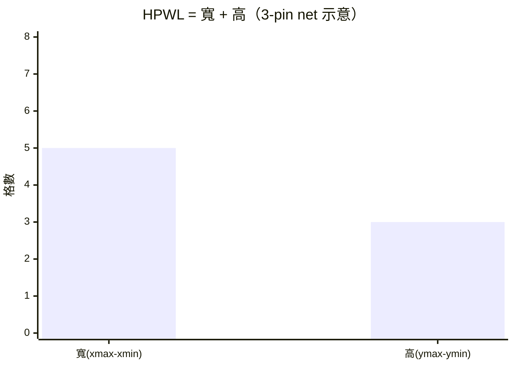

# 3.1 佈局問題：二次分配與 NP 困難（1957 — Koopmans & Beckmann）

## 佈局在解什麼問題

科技映射給了我們一張 cell 清單和它們之間的連線（net）。佈局要回答：
**每個 cell 放在晶面/晶格的哪個座標？**

好的佈局只有一個目標函數（多目標是後話）：**連線總長度短**。
線短 → 延遲低、功耗低、繞線資源省。佈局的品質決定了後面所有步驟的天花板。

## 數學形式：二次分配問題

1957 年 Koopmans 與 Beckmann 把這類「工廠選址」問題形式化為**二次分配問題**
（Quadratic Assignment Problem, QAP）：

給定流量矩陣 $F = [f_{ij}]$（cell $i$ 與 $j$ 之間的連線數）與距離矩陣
$D = [d_{kl}]$（槽位 $k$ 與 $l$ 的距離），找一個排列 $\pi$：

$$\min_{\pi \in S_n} \; C(\pi) = \sum_{i=1}^{n}\sum_{j=1}^{n} f_{ij}\; d_{\pi(i)\,\pi(j)}$$

- $n$ 個 cell、$n$ 個槽位、一一對應（FPGA 版：$n$ 個 cell 放進 $26\times26$ 的格點，
  槽位多於 cell，補 dummy 即同構）。
- **二次**：成本項是「流量 × 距離」的乘積——連線的兩端都要動，成本隨兩端位置同時變化。
- QAP 是組合最佳化裡最難的問題類之一：$n=30$ 的實例就能讓精確演算法（分支定界）
  燒到天荒地老。

## NP 困難意味著什麼

QAP 包含旅行推銷員問題（TSP）為特例（令 $F$ 為環狀流量），因此 **NP 困難**。
這不是「電腦快一點就好」的問題：

| $n$ | $S_n$ 排列數 | 每秒評 $10^9$ 個排列 |
|---|---|---|
| 20 | $2.4\times10^{18}$ | 77 年 |
| 344（CPU 的 LUT 數） | $\approx 10^{737}$ | 宇宙熱寂後也沒跑完 |

> **理論結論**：佈局必須放棄「最佳解」，擁抱「夠好的解」。
> 這個妥協催生了 EDA 佈局演算法的三大流派：
> 解析法（force-directed、quadratic placement）、分割法（min-cut, Kernighan–Lin 1970）、
> 與**隨機搜尋法**（模擬退火）——本專案選第三派，因為它最透明、最可視化（見 3.2 節）。

## 目標函數的工程化：半周長線長

精確的線長要在繞線後才知道（實際走線受通道約束），佈局階段用**估計**：
**半周長線長**（Half-Perimeter Wire Length, HPWL）。對一條 net（驅動器＋若干接收器）：

$$\text{HPWL}(net) = (x_{\max} - x_{\min}) + (y_{\max} - y_{\min})$$



HPWL 之所以是標準選擇：對 2-pin/3-pin net 它就是 minimum Steiner tree 的良好近似、
且計算是 $O(\text{pin 數})$ 的常數次減法。本專案 `MicroPnR.place` 的退火成本函數就是
全網表 HPWL 總和：

```js
// lib/fpga/pnr.js — cost()（節錄）
for (const net of nets) {
  // 對 net 上所有 cell 座標取 min/max
  cost += (maxX - minX) + (maxY - minY);   // ← HPWL
}
```

## 佈局的搜索空間：鄰域結構

退火/局部搜尋類演算法需要定義「**鄰域動作**」。本專案用的是最簡單的
**隨機對調**（pairwise swap）：隨機挑兩個 cell 交換槽位。

```js
const x1 = Math.floor(Math.random() * W);   // 隨機格點 1
const y1 = Math.floor(Math.random() * H);
const x2 = Math.floor(Math.random() * W);   // 隨機格點 2
const y2 = Math.floor(Math.random() * H);
// swap 兩格上的 cell，計算 ΔCost
```

這個選擇的理論意涵：swap 鄰域讓搜索空間**連通**（任何排列都能透過有限次 swap 到達），
保證退火理論上能到達全域最優——收斂速度是另一回事（見 3.2 節）。

## ASIC 佈局的另一條路

FPGA 是「格點已固定」的問題，swap 鄰域自然。ASIC 標準單元流程則傳統上用
**row-based** 佈局：所有 cell 等高、排成一排排的橫列（如圖書館書架），
允許在列內滑動。本專案 `AsicPnR` 用最簡的**拓撲深度成列**（level→row），
不做事後最佳化——把「為什麼真實工具要在列內做交換/鬆弛」留給讀者對照 3.4 節思考。
