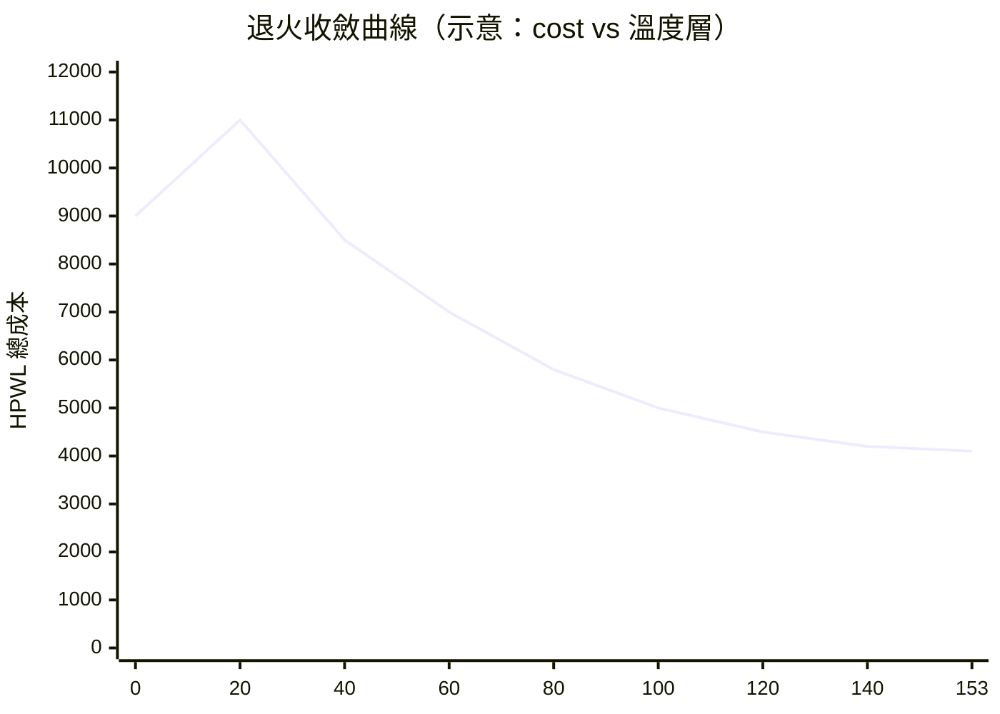

# 3.2 模擬退火：Metropolis 1953 到 Kirkpatrick 1983

## 熔爐裡長出來的演算法

1953 年，Metropolis 等人在模擬固體退火時提出一個採樣準則：系統在溫度 $T$ 下，
從狀態 $s$ 跳到能量更高的狀態 $s'$ 的機率是

$$P(\text{accept}) = \min\left(1,\; e^{-\Delta E / k_B T}\right)$$

其中 $\Delta E = E(s') - E(s)$。高溫時什麼都接受（自由探索），低溫時只接受變好
（貪下山）。配合**緩慢降溫**，系統會落入能量最低的晶格結構——退火。

1983 年，Kirkpatrick、Gelatt、Vecchi 在《Science》上把這套準則搬進組合最佳化：
把能量換成目標函數、狀態換成解、溫度換成控制參數，就是**模擬退火**
（Simulated Annealing, SA）。它給 NP 困難問題一個帶理論保證的答案形式：
*降溫足夠慢時，收斂到全域最優的機率趨近 1*（Geman & Geman 1984 的理論結果；
實務上沒人等得起，但收斂趨勢是真的）。

## 為什麼佈局特別適合 SA

佈局有三個性質，恰好對上 SA 的強項：

1. **搜索空間巨大且崎嶇**（3.1 節：$10^{737}$ 種排列）——貪心法會卡死在局部谷底；
2. **目標函數可增量評估**——swap 兩個 cell 只影響它們參與的 net，
   $\Delta C$ 不必重算全網表；
3. **沒有明顯的解析結構**可利用（離散格點、net 大小不一）——解析法（二次佈局）需要
   連續鬆弛，FPGA 的離散性反而礙事。

## MicroPnR 的退火實現

```js
// lib/fpga/pnr.js — place()（節錄）
let temp = 100.0;
const coolingRate = 0.94;
while (temp > 0.05) {
  // 每個溫度層：掃描全部 cell 嘗試隨機對調
  const delta = newCost - currentCost;
  if (delta < 0 || Math.random() < Math.exp(-delta / temp)) {
    // 接受：變好一律收；變壓看機率
  }
  temp *= coolingRate;      // 幾何降溫
  this.onSample?.({ temp, cost: currentCost, move });  // 退火動畫取樣
}
```

三個參數就是教科書三件套：

| 參數 | 值 | 理論角色 |
|---|---|---|
| 初溫 $T_0$ | 100.0 | 高溫期 $\approx$ 隨機遊走（$e^{-\Delta/T}\approx 1$） |
| 降溫率 $\alpha$ | 0.94 | 幾何冷卻 $T_k = T_0\alpha^k$；Geman 理論要求 $\alpha \to 1$（對數降溫），實務用幾何 |
| 終溫 $T_{\min}$ | 0.05 | $\Delta=1$ 時 $e^{-1/0.05}\approx 2\times10^{-9}$，等效貪心 |

從 100 降到 0.05、每層乘 0.94：$\lceil \ln(0.05/100)/\ln 0.94 \rceil \approx 153$ 個溫度層。
每層做一輪全 cell 掃描，總評估次數 $\approx 153 \times |cells|$——CPU 案例 392 cells
約 6 萬次增量評估，瞬間跑完（真實工具每層會做數百到數千次移動，本專案取最小可視化規模）。

## 退火曲線：看得見的收斂



初期 cost 反而**上升**（高溫允許變壞的移動逃出局部谷），中期快速下滑，
後期收斂變平。`onSample` 回呼把 $(T, cost)$ 每層記下來，`hdl.html` 的
「▶ 退火動畫」按鈕就是拿這組 snapshot 逐層重播佈局畫面——**演算法的動力學，
直接變成動畫**。

## 增量評估：SA 可用的關鍵工程

全量重算 cost 是 $O(\sum_{net} \text{pins})$；增量評估只算受 swap 影響的 net
（兩個 cell 參與的所有 net），通常小一兩個數量級。真實退火佈局器（如 TanseN、
nextpnr）的全部工程技巧幾乎都在這裡：鄰域選擇（優先選有連線的 cell 對）、
net box 快取、區域化移動。本專案為了程式透明度先做全量式評估，把「增量」留成
一個明確的習題。

## 佈局結果的品質

Hack CPU（344 LUT + 48 DFF = 392 cells）退火後：

| 指標 | 值 |
|---|---|
| 網格 | 26×26（維持約 60% 利用率） |
| 總 HPWL | 約 4,100 單位（SA 隨機，每次略異） |
| 密度 | 0.58 |

線長只是**估計**——實際能不能繞得通、要繞多長，要等下一節的迷宮繞線說了算。
