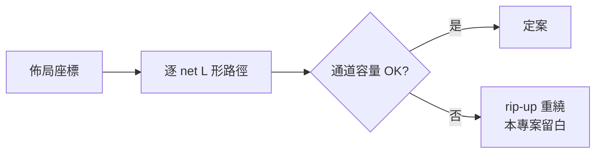

# 3.3 迷宮繞線：Lee 1961 與曼哈頓通道

## 佈局給了位置，繞線給了路

佈局把 cell 釘在格點上，但 net 只是抽象的「這幾個 cell 要連通」。
繞線（routing）要為每條 net 找出**實際的幾何路徑**，而且所有 net 的路徑彼此不能短路。

這是兩層問題：

1. **全局繞線**（global routing）：把每條 net 分配到大致的通道（channel）；
2. **詳細繞線**（detailed routing）：在通道內排出不衝突的具體走線。

本專案 `MicroPnR.route` 用最直接的做法：逐 net 走 L 形曼哈頓路徑（先水平後垂直），
通道容量（每通道 6 tracks）決定衝突與否——這是把兩層合併的最小可行版本。

## 迷宮演算法：BFS 的柵格版

1961 年 C. Y. Lee 的迷宮演算法是詳細繞線的祖師爺：把晶面看成柵格，
每格是一個節點、相鄰格之間有邊，起點到終點的最短路就是 **BFS**。
BFS 在無權圖上保證找到最少格數的路徑，這就是「迷宮老鼠」的數學。

```mermaid
graph LR
    subgraph 柵格 BFS（Lee 1961）
        S[S 起點] --> A[.]
        A --> B[.]
        B --> T[T 終點]
        S --> X[x 牆] -.->|繞過| B
    end
```

現代工具用 **A\*** 加速：BFS 加上曼哈頓距離啟發函數 $h(n) = |x_n - x_t| + |y_n - y_t|$
（admissible，因為曼哈頓距離是不繞路的下界），搜索方向被引導到終點，
實務快一兩個數量級。本專案 `route` 的註解即標明「A* Maze Router」精神。

## 本專案的 L 形曼哈頓路徑

`route()` 對每條 net 的每個 sink 走固定形狀的兩段線：

```js
// lib/fpga/pnr.js — route()（節錄）
for (const sink of net.sinks) {
  // 以曼哈頓路徑畫線 (經水平然後垂直通道)
  const midX = dst.x;
  const midY = src.y;
  segments.push({ x1: src.x, y1: src.y, x2: midX, y2: midY }); // 水平段
  segments.push({ x1: midX, y1: midY, x2: dst.x, y2: dst.y }); // 垂直段
  const len = Math.abs(src.x - dst.x) + Math.abs(src.y - dst.y); // 曼哈頓距離
}
```

- **路徑形狀固定為 L**（水平→垂直）：犧牲繞線自由度，換來確定性的、可視覺檢查的路徑；
- **線長 = 曼哈頓距離**：$|x_s - x_t| + |y_s - y_t|$，這個量會直接進 STA
  （0.25 ns/格，第 4.3 節）；
- 衝突偵測：同通道、同 track 的重疊段計為衝突（`tracksPerChannel = 6`）。

> **理論取捨**：固定 L 形放棄了「繞開障礙」的能力——若兩 cell 之間剛好被別的 net
> 隔開，L 形會撞牆。真實迷宮繞線器的存在意義正在於此：遇到擁塞時自動繞路，
> 並在繞路與換 track 之間做權衡。這是本專案清單上最值得擴充的一塊。

## 為什麼是曼哈頓？

晶片佈線層是正交柵格（金屬層走水平/垂直），兩點間的最短可行路徑長度就是曼哈頓距離：

$$d_M\big((x_1,y_1),(x_2,y_2)\big) = |x_1 - x_2| + |y_1 - y_2|$$

這讓整個 EDA 幾何學都建立在 $L_1$ 範數上（而非歐氏 $L_2$）——HPWL、繞線長度、
線延遲模型，全部同源。**一個範數選擇，貫穿三個 EDA 階段**，這是 1.2 節
「支柱相依」的具體體現。

## 繞線品質與「繞不通怎麼辦」

Hack CPU 實測：392 cells、26×26 網格、總線長約 4,100 單位（SA 隨機性使每次略異）。
當某通道超過 6 tracks 的容量時會產生未繞完/衝突標記——真實流程的解法是
**拆線重繞（rip-up and reroute）**：把撞車的 net 拆掉、換 track、再試。
本專案把 rip-up 留作擴充方向；讀者可以在 hdl.html 的繞線視圖裡
親眼找找有沒有衝突痕跡。


