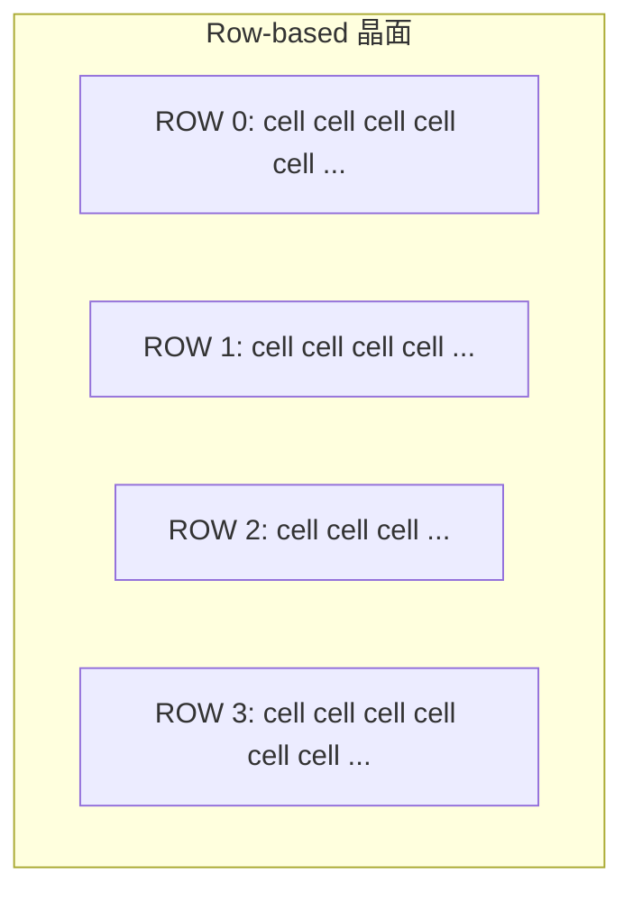

# 3.4 ASIC row-based 佈局：標準單元與等高列

## 標準單元的世界觀

ASIC 佈局與 FPGA 根本不同：FPGA 的格點是製造時就焊死的架構（CLB 網格），
ASIC 的晶面則是**空白的**——設計者把數萬個**標準單元**（standard cell，
等高的預設計電路塊）排進一排排的**列**（row），像書架上排書。



- 列高固定（本專案 `ROW_H_UM = 2.2` µm）；
- cell 寬度 ∝ 面積（INV 1.0 µm²、NAND2 2.0、AOI21 3.2、MUX2 4.0、DFF 8.0）；
- 電源軌沿列水平走，訊號在列與列之間垂直連通。

## 拓撲深度成列：最簡的合法佈局

`AsicPnR.place` 不做最佳化，而是用一個**結構性啟發**：按每個 cell 的
**拓撲深度（level）**分列——訊號從輸入流到輸出，深度相同（同拍內同樣遠）的 cell 放同一列，
**DFF 輸出視為深度 0**（新的一拍重新開始）。

```js
// lib/asic/pnr.js — place()（節錄）
const getLevel = (netName) => {
  // 記憶化遞迴：level(net) = max(level(各輸入)) + 1
  if (c.type === 'DFF') lv = 0;   // DFF 輸出重置（新 stage）
  return lv;
};
```

這個啟發的理論依據來自**同步電路的拍級結構**（第 4.1 節）：DFF 把電路切成一拍一拍的
組合區域；同拍內的邏輯按深度排列，等於把**關鍵路徑的幾何走向**與**拓撲深度**對齊——
深信號走的幾何距離自然變長，這既方便 STA 讀圖，也暗示了延遲與深度的正相關。

Hack CPU 的 ASIC 映射結果排成 **139 列**，最寬列 172.8 µm。

## 為什麼真實工具還要在列內做最佳化

拓撲成列只保證「合法」（cell 不重疊、等高），不保證「好」。真實流程（如 Cadence Innovus）
在成列之後還有兩大步：

1. **列內滑動與交換**（placement legalization + optimization）：
   把同列內 cell 順序按連線關係重排，減少相鄰列之間的交叉；
2. **時序驅動的 cell 移動**：把關鍵路徑上的 cell 拉近、加緩衝器（buffer insertion）。

本專案刻意停在「合法即止」，把量化的落差攤在第 5.3 節：總線長約 91,700 µm——
比 FPGA 版（3,954 單位，但單位不同）大得多，正是「沒做事後最佳化」的直接後果。

## ASIC 的線長與延遲估計

ASIC 沒有通道格點，線延遲直接用幾何距離估：

$$t_{\text{wire}} = 0.01\; \text{ns/µm} \times d_{\text{µm}} \;+\; 0.02\;\text{ns} \times \text{fanout}$$

```js
// lib/asic/pnr.js
const WIRE_NS_PER_UM   = 0.01;   // 每 µm 線延遲（示意）
const LOAD_NS_PER_SINK = 0.02;   // fanout 負載項
```

- **距離項**：driver 與 sink 的幾何距離（µm）——沒有柵格，就沒有曼哈頓格數，
  但仍是 $L_1$ 距離；
- **負載項**：fanout 越多，driver 要推的電容越大（Elmore 延遲的粗略影子，
  $t \approx RC$，$C \propto$ fanout）。

> **理論根據**：這兩項是 Elmore delay 模型（1948）的最粗近似。
> 真實工具用線負載模型（wire load model）或寄生參數提取（RC extraction），
> 精度與代價都高幾個數量級。

## FPGA vs ASIC 佈局的對照表

| 面向 | FPGA（MicroPnR） | ASIC（AsicPnR） |
|---|---|---|
| 晶面模型 | CLB 網格＋通道 | row-based 等高列 |
| 鄰域/啟發 | SA 隨機對調 | 拓撲深度成列 |
| 位置自由度 | 離散格點 | 列內連續（本專案未用） |
| 線長估計 | HPWL（格數） | 幾何距離 µm |
| 延遲模型 | LUT 1.2ns＋0.25ns/格 | cell 延遲＋0.01ns/µm＋0.02ns/fanout |
| 佈局後最佳化 | 繞線衝突可見 | 無（留白） |

兩條後端從**同一張 NAND 網表**出發（第 2 章），在世界觀分岔的佈局層各自落地，
最後在**時序分析**（第 4 章）重新會合——因為無論 cell 怎麼擺，
「最長路徑定 Fmax」的物理鐵律是同一條。
