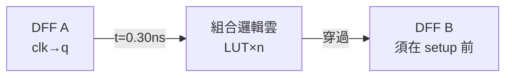

# 4.1 靜態時序分析：到達時間與關鍵路徑

## 一個時脈週期裡發生了什麼

同步電路的心跳是時脈。一拍之內：



1. 時脈上升，DFF A 輸出新值（延遲 $t_{\text{clk}\to q}$）；
2. 訊號穿過一串組合邏輯（每顆 LUT/cell 有延遲，每段線有線延遲）；
3. 訊號必須在**下一個時脈上升沿之前** $t_{\text{setup}}$ 到達 DFF B 的輸入。

三段加總不得超過時脈週期 $T$。**最慢的那條路**（關鍵路徑）決定一切：

$$T \ge t_{\text{clk}\to q} + \max_{\text{路徑 } p} t_{\text{logic}}(p) + t_{\text{setup}}
\qquad F_{\max} = \frac{1000}{T_{\min}\;[\text{ns}]}\;\text{MHz}$$

## STA 的聰明處：不跑模擬

驗證時序有兩條路：

- **動態模擬**：餵輸入向量、逐週期模擬、量每條路徑——但輸入向量是 $2^n$ 空間，
  永遠測不完（覆蓋率問題）；
- **靜態分析（STA）**：把「所有可能路徑的最長者」直接當**圖上最長路問題**解掉，
  與輸入向量無關——故名「靜態」。

組合邏輯是 DAG（2.1 節），DAG 上最長路用拓撲排序一次搞定：

$$t_{\text{arrival}}(net) = \max_{net' \in \text{drivers}(net)} \big(t_{\text{arrival}}(net') + t_{\text{cell}} + t_{\text{wire}}\big)$$

複雜度 $O(|V|+|E|)$。**最長路在一般圖上是 NP 困難的（有正環時），
但在 DAG 上是動態規劃的送分題**——這正是 DFF 切環的又一次紅利（第一次是求值，
第二次是 STA）。

## MicroPnR.analyzeTiming

```js
// lib/fpga/pnr.js — analyzeTiming()（節錄）
const getArrival = (netName) => {
  // 記憶化遞迴：max(各輸入的 arrival) + LUT 延遲 + 線延遲
  arrivalTimes.set(netName, maxIn);
  return maxIn;
};
// 評估所有 PO 與 DFF 輸入端的到達時間
for (const out of netlist.outputs) { /* max 更新 criticalRoot */ }
for (const dff of netlist.dffs) {
  const arr = getArrival(dff.in) + this.dffDelay;
  // 同上
}
const criticalPathNs = Math.max(maxDelay, 0.5);
const fmaxMHz = 1000.0 / criticalPathNs;
```

四個要點：

1. **終點集合**：不是只有 PO——**DFF 的輸入**也是路徑終點（下一拍的起點），
   程式把兩類都掃（`netlist.outputs` 與 `netlist.dffs`）；
2. **遞迴＋記憶化**：`getArrival` 就是拓撲最長路的遞迴式，遇到 DFF 邊界自然停止
   （DFF 輸出是起點，到達時間 0）；
3. **線延遲進入逐段計算**：每段繞線長 × 0.25 ns/格——繞線結果（3.3 節）在此回饋進時序，
   支柱相依的閉環；
4. **Fmax 下限保護**：`Math.max(maxDelay, 0.5)`，避免零延遲除零。

## 回溯關鍵路徑

報告數字不夠，要指出**是哪條路**。程式從 criticalRoot 往回走：
在每個 LUT 的輸入中挑 arrival 最大者，一直走到起點：

```js
// 回溯尋找關鍵路徑節點
let curr = criticalRoot;
while (curr) {
  criticalPath.unshift(curr);
  let worstInput = lut.inputs[0], worstT = 0;
  for (const inp of lut.inputs) {
    const t = arrivalTimes.get(inp) || 0;
    if (t >= worstT) { worstT = t; worstInput = inp; }
  }
  curr = worstInput;
}
```

這條 net 序列就是 **timing report 的關鍵路徑**——真實工具的報告會列出每一級的
cell 名、延遲、線長，供工程師「修路」（重整邏輯、加管線、升級單元）。

## Hack CPU 的關鍵路徑

FPGA 後端實測：

| 指標 | 值 |
|---|---|
| 關鍵路徑延遲 | 45.55 ns |
| $F_{\max}$ | 22.0 MHz |

45 ns ÷ 1.2 ns/LUT ≈ 38 級 LUT 串聯（含線延遲）——這是一個**未做任何時序最佳化**
的結果。真實流程的下一步（retiming、邏輯重整、物理優化）都是為了把這條 38 級的
長路切短。ASIC 後端同樣的電路算出 28.75 ns（34.8 MHz），
兩者的差別全部來自延遲模型（第 4.3 節）。

> **思想小結**：STA 是「圖論 + 物理模型」的合體——圖論（DAG 最長路）給出算法骨架，
> 物理模型（cell/線延遲）給出數字。模型換了，數字就換；骨架不變。
