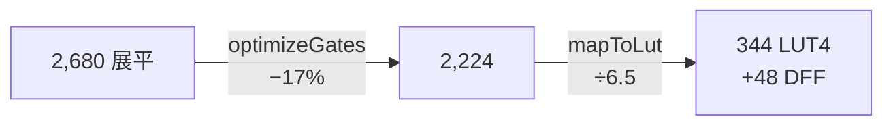

# 5.1 從 2680 閘到 2224：化簡實錄

## 案例對象：Hack CPU（project 05）

Hack CPU 是 Nand2Tetris 前半程的總成：取指、解碼、ALU、暫存器寫回，
全部用 01–03 章的積木疊成。它的 HDL（`third_party/courses/05/CPU.hdl`）
引用 ARegister/DRegister/ALU/PC 等子晶片，階層樹深四層。

本節起的所有數據都是本機實跑（重現命令見 README.md）。

## 第一步：展平（flatten）

```text
# CPU.hdl 階層樹
CPU ──┬── ALU ──── Add16 ── FullAdder ── ...（Nand 底）
      ├── ARegister ── Bit ── DFF
      ├── DRegister ── Bit ── DFF
      └── PC ── Inc16 ── Add16 ── ...
```

展平結果：**2,680 顆位元級閘**（NAND 為主，含 48 顆 DFF）。
每個 16-bit 暫存器展成 16 個 Bit、每個 Bit 展成 mux+DFF 的 NAND 形式——
結構共用全部消失，換來一張全域可分析的圖。

## 第二步：最佳化（optimizeGates）

不動點迭代跑完（2.3 節三式代數），2,680 → **2,224**，減少 456 顆（−17%）。

這 456 顆是誰？三個來源：

1. **常數吸收**：HDL 裡的 `load=false` 固定接線、mux 選擇端接死——
   NAND 一腳接常數後整顆消失，並連鎖觸發上游死碼；
2. **雙重否定**：`Not`＋`Not` 成對出現（mux 重組、alu 的 y 倒相鏈）；
3. **死碼**：展平過程產生的中間 net 無人引用。

## 全語料化簡對照表

| 晶片 | 展平 | 化簡後 | 減幅 | 化簡來源 |
|---|---|---|---|---|
| Inc16 | 384 | 224 | **−42%** | 進位鏈末端恆定 → 常數吸收連鎖 |
| PC | 912 | 640 | −30% | 常數吸收＋死碼 |
| ALU | 1,278 | 1,174 | −8% | 少量雙重否定 |
| CPU（總成） | 2,680 | 2,224 | −17% | 以上之和 |
| And/Mux/DMux 系列 | — | — | **0%** | 無冗餘 |

兩個極端值得深究（第 5.4 節展開）：

- **Inc16 的 −42%**：一個「只用來 +1」的加法器，半數硬體是為通用性而生——
  課程复用 `Add16` 直接損失了專用化的機會，化簡器把這份損失賺了回來；
- **ALU 的 0 差異級別**：ALU 的控制訊號（zx/nx/zy/ny/f/no）直接參與邏輯，
  沒有常數可吸——結構即本質。

## 第三步：映射（mapToLut）

2,224 顆 NAND+DFF 打包成 **344 顆 LUT4 ＋ 48 顆 DFF**：

| 統計 | 值 |
|---|---|
| rawGates（化簡後） | 2,224 |
| LUT4 | 344 |
| DFF | 48 |
| 平均壓縮比 | 2,224 / 344 ≈ **6.5 NAND/LUT** |

6.5 的平均壓縮比說明錐擴張貪得健康：4-LUT 理論上限是「任意 4 輸入錐」，
6.5 顆 NAND 平均只需要 4 個輸入腳，表示大量進位鏈/選擇樹被完整打包。



## 之後的故事

網表交給佈局繞線（3 章）與時序分析（4 章），總結在第 5.2/5.3 節：
FPGA 上 26×26 格、Fmax 22.0 MHz；ASIC 上 1,348 個標準單元、Fmax 34.8 MHz。
先記住一條主線：**每一站的成功都依賴前一站的輸出品質**——
如果 2,680 沒化成 2,224，LUT 會多 70 顆、線長更長、Fmax 更低。
EDA 是一條品質傳導鏈。
