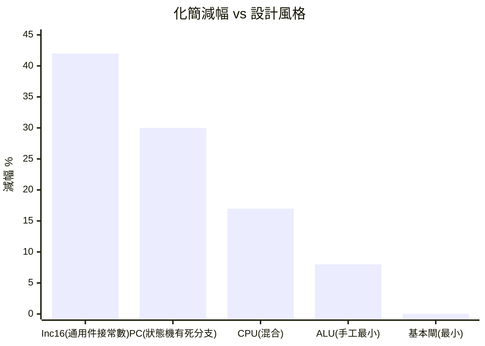
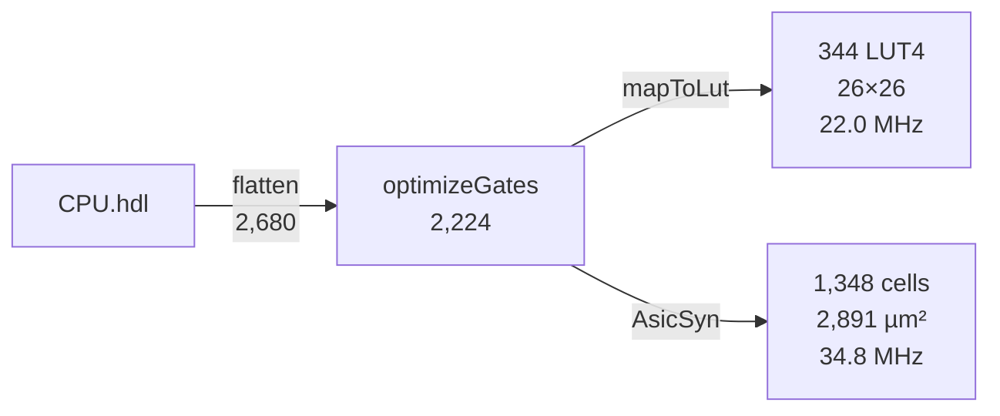

# 5.4 化簡的教訓：Inc16 減 42% 與 ALU 零差異

## 一個對照組：誰賺走了化簡紅利

把全語料的化簡收益排開，兩端差距驚人：

| 晶片 | 展平 | 化簡後 | 減幅 |
|---|---|---|---|
| Inc16 | 384 | 224 | **−42%** |
| PC | 912 | 640 | −30% |
| CPU | 2,680 | 2,224 | −17% |
| ALU | 1,278 | 1,174 | −8% |
| And/Mux/DMux 系列 | — | — | **0%** |

**同一個最佳化器，收益差 42 個百分點。** 這一章解釋為什麼——
而答案是整本書最核心的工程教訓：**化簡空間是設計風格的影子**。

## 案例 A：Inc16 的 −42%

`Inc16` 的 HDL 只有一行：

```hdl
CHIP Inc16 { IN in[16]; OUT out[16];
    PARTS: Add16(a=in, b[0]=true, b[1..15]=false, out=out);
}
```

把通用 `Add16`（行波進位加法器）的 `b` 端接死成 `0000000000000001`。
展平後，Add16 內部為「通用加法」準備的全加器本位項、b 側選擇邏輯全部面對常數：

$$\text{NAND}(0, x) = 1 \;\Rightarrow\; \text{連鎖吸收}$$

- `b[0]=true` → 全加器第 0 位退化成**半加器**（少一串閘）；
- `b[1..15]=false` → 第 1–15 位的 b 輸入分支整片死亡；
- 進位鏈的傳播條件簡化 → 又一串死碼。

42% 的電路是「為不存在的輸入準備的」。**化簡器賺回的是通用性稅。**

## 案例 B：ALU 的 −8% 與基本閘的 0%

Hack ALU 的控制介面：

```text
zx, nx, zy, ny, f, no —— 六個控制訊號直接參與資料通路的 mux/倒相
```

每個控制訊號都驅動真實硬體（zeroing mux、invert mux、and/or 選擇、
輸出取反）——沒有常數、沒有雙重否定、沒有死碼。
化簡器面對的是**已經最小化的結構**：Nand2Tetris 的 ALU 本來就是
按布林恆等式手工設計的。

And/Mux/DMux 系列 0% 同理：兩三顆 NAND 疊出的最小閘，等價類裡沒有更小的。

## 三條教訓

### 教訓一：化簡收益 ∝ 設計的「通用性浪費」



高層複用（Inc16 用 Add16）買了開發速度，付了面積；化簡器是這筆交易的**結算所**。
真實工業流程中，這正是「為什麼要寫參數化生成器而不是到處例化通用模組」的量化依據。

### 教訓二：局部三式 ≠ 全域最佳

`optimizeGates` 只做常數吸收/雙重否定/死碼，卻賺到 42%——
因為課程電路的冗餘**恰好都是這三類**。換一個設計風格（例如編譯器生成的
隨機邏輯），同樣的三式可能只賺 3%，真正需要的是 AIG rewriting（exhaustive
局部重寫，abc 的經典招）。**最佳化器的選型要對著設計風格來。**

### 教訓三：化簡的紅利會一路傳導

2,680 → 2,224 不是終點，而是全鏈路的起點：

| 傳導 | 若不化簡（2,680 起步） | 實際（2,224） |
|---|---|---|
| LUT4 | 約 415 顆 | 344 顆 |
| 網格 | 27×27 | 26×26 |
| 線長 | 更長（多 70+ cell 的連線） | 3,954 |
| ASIC cells | 約 1,590 | 1,348 |
| 面積 | 約 3,400 µm² | 2,891.6 µm² |

**前段省 1，後段省多**——EDA 品質傳導鏈（5.1 節結尾）的量化版本。

## 尾聲：從 Nand 到晶片的完整閉環

本書的旅程：



1965 年的設計危機（1.1 節）在這張圖裡被完整回應：
**HDL 進，晶片參數出**。中間的每一步——Shannon 的代數（2.1）、
Sheffer 的完備性（2.2）、代數重寫的不動點（2.3）、錐覆蓋（2.4）、
Metropolis 的熔爐（3.2）、Lee 的迷宮（3.3）、DAG 上的最長路（4.1）——
都是真實 EDA 工具的內臟，只是縮小到一個人讀得完的體積。

接下來若想繼續深入，四個明確的擴充方向（按理論依賴排序）：
樹覆蓋 DP 映射（2.4）、增量評估退火（3.2）、rip-up 重繞（3.3）、
時序驅動佈局（4.3）。每一個都有現成的接點與測試保護。
